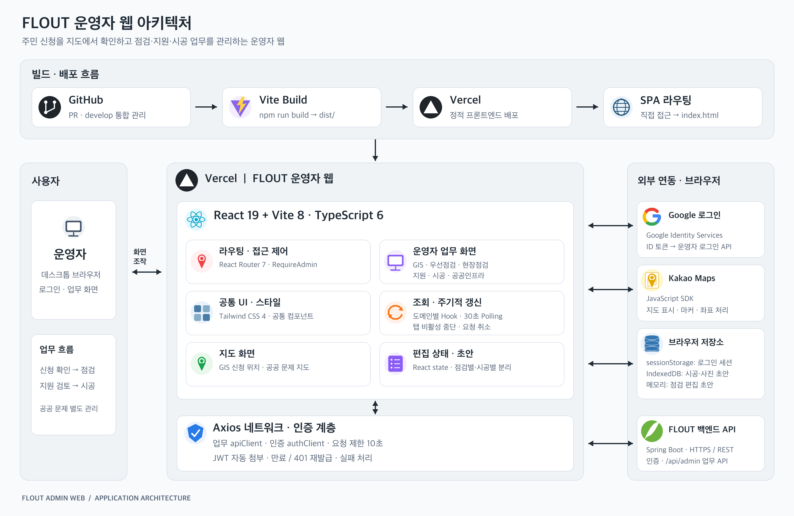

<div align="center">

# FLOUT · Admin Web

**주민의 침수 예방 신청을 현장점검부터 지원·시공까지 연결하는 운영자 웹**

부천시 반지하 주택 주민을 위한 침수 예방 플랫폼, FLOUT의 운영자 프론트엔드입니다.

[운영자 웹 바로가기](https://flout-admin-web.vercel.app/login) · [백엔드 API 문서](https://api.flout.shop/swagger-ui/index.html) · [주민용 프론트엔드](https://github.com/CUK-FLOUT/flout-resident-webapp)

</div>

---

<a id="overview"></a>

## 프로젝트 소개

FLOUT은 **부천시 반지하 주택 주민을 위한 침수 예방 플랫폼**입니다. 주민은 침수 위험을 확인하고 현장점검과 예방시설 지원을 신청하며, 운영자는 접수된 신청을 바탕으로 점검·지원·시공 업무를 관리합니다.

운영자 웹은 주민용 웹앱과 분리된 프론트엔드이며, 동일한 FLOUT 백엔드 API와 연결됩니다. 지도에서 신청 위치와 취약도를 확인하고, 우선점검 지정·방문 일정 배정·점검 결과 공개·지원 승인·시공 완료로 이어지는 업무를 처리합니다. 지역·공공시설의 문제는 공공인프라 관리에서 별도로 검토합니다.

```text
주민 신청 → GIS 신청 확인 → 우선점검 지정 → 현장점검·결과 공개 → 지원 검토 → 시공 관리
                                           └ 지역·공공 문제 → 공공인프라 검토·조치
```

위 흐름은 운영자가 사용하는 주요 화면의 연결을 설명합니다. 실제 처리 가능 여부와 상태 전이는 각 API의 서버 정책을 따릅니다.

<a id="features"></a>

## 주요 기능

| 화면 | 주요 기능 | 기본 경로 |
| --- | --- | --- |
| **운영자 로그인** | 이메일·Google 로그인, 인증 화면 보호, 토큰 재발급 및 로그아웃 | `/login` |
| **GIS 신청 관리** | 신청 검색·필터, 위치 마커·현황, 신청 상세·처리 이력 및 내부 메모 | `/gis` |
| **우선점검 관리** | 후보 비교, 복수 대상 지정·취소, 드래그 및 이동 버튼을 통한 선정 순서 변경·저장 | `/priority` |
| **현장점검 관리** | 상태별 목록, 담당자·방문 일정 배정, 저장된 배정 정보 확인 | `/inspection` |
| **점검 결과** | 취약지점·전문가 의견·권장 예방조치 작성, 사진 첨부, 임시 저장·결과 공개·조회 | `/inspection/:requestId/results` |
| **지원 관리** | 신청 현황·목록·상세, 지원 자격 검토, 동의서 제출 여부 확인, 승인·미승인 처리 | `/support` |
| **시공 관리** | 시공 대상·상세 조회, 일정 저장, 사진 첨부 및 전체 완료 처리 | `/construction` |
| **공공인프라 관리** | 지역 문제 지도·목록, 검토 내용 저장, 조치 결과·사진 등록 | `/infrastructure` |

- `/`로 접속하면 GIS 신청 관리로 이동합니다.
- 운영자 업무 화면은 인증된 세션이 있어야 접근할 수 있습니다.
- 주요 목록은 주기적으로 갱신하고, 검색·필터·페이지 조건과 상세 편집 상태를 구분해 관리합니다.

<a id="tech-stack"></a>

## 기술 스택

### Frontend

<p align="center">
  
  
  
</p>
<p align="center">
  
  
  
</p>

### Integration & Deployment

<p align="center">
  
  
  
</p>

### Development & Quality

<p align="center">
  
  
  
  
</p>

| 구분 | 구성 및 용도 |
| --- | --- |
| UI·타입 | React 19, TypeScript 6 |
| 개발·빌드 | Vite 8, React Vite 플러그인 |
| 스타일·아이콘 | Tailwind CSS 4, SVG 에셋, Lucide React |
| 라우팅 | React Router 7, `RequireAdmin` 기반 접근 제어 |
| API 통신 | Axios, 업무·인증 클라이언트 분리 |
| 데이터 조회·편집 | 도메인별 Hook, React state, 공통 `usePagePolling` |
| 외부 연동 | Kakao Maps JavaScript SDK, Google Identity Services |
| 저장소 | sessionStorage, IndexedDB, 메모리 기반 편집 초안 |
| 테스트·품질 | Node.js 기본 테스트 러너, ESLint, TypeScript, Prettier |
| 배포·협업 | Vercel, GitHub, GitHub Actions의 이슈·PR 제목 자동화 |

버전은 [package.json](package.json)의 주요 버전 기준입니다. 서버 상태 조회의 주요 구현은 도메인별 Hook과 공통 Polling이며, GitHub Actions에 lint·build CI가 구성된 것으로 표시하지 않습니다.

<a id="architecture"></a>

## 시스템 아키텍처



[고해상도 PNG](docs/images/flout-admin-architecture.png) · [편집 가능한 SVG 원본](docs/images/flout-admin-architecture.svg)

| 계층 | 역할 |
| --- | --- |
| **사용자** | 운영자가 데스크톱 브라우저에서 로그인하고 신청·점검·지원·시공 업무 수행 |
| **프론트엔드** | Vercel에서 제공하는 React SPA. 화면·공통 UI·도메인별 조회 및 편집 로직 구성 |
| **네트워크·인증** | Axios 클라이언트가 JWT 첨부, 토큰 재발급·재요청 및 오류 처리 수행 |
| **백엔드** | FLOUT Spring Boot 서버의 인증·운영자 REST API 사용 |
| **외부 SDK** | Google 로그인과 Kakao 지도 기능을 브라우저에서 연동 |
| **브라우저 저장소** | 로그인 세션, 시공·사진 초안 및 점검별 미저장 편집 내용 보관 |

Vite로 생성한 `dist/`를 Vercel에 배포합니다. [vercel.json](vercel.json)의 rewrite 설정으로 상세 URL 직접 접근과 새로고침에도 SPA 진입 파일인 `index.html`을 제공합니다.

<a id="structure"></a>

## 프로젝트 구조

```text
flout-admin-web/
├── .github/
│   ├── workflows/              # 이슈·PR 제목 자동화
│   └── ...                     # 이슈·PR 템플릿
├── docs/
│   └── images/                 # README 아키텍처 PNG·SVG
├── src/
│   ├── api/                    # 도메인별 API·요청/응답 타입·Axios 클라이언트
│   ├── auth/                   # 세션·보호 라우트·Google 로그인
│   ├── assets/                 # 화면별 아이콘·이미지
│   ├── components/
│   │   ├── common/             # 드롭다운·페이지네이션·사진·검색 스타일
│   │   ├── layout/             # 사이드바·헤더·프로필 메뉴·업무일자
│   │   └── ...                 # 도메인별 화면 컴포넌트
│   ├── hooks/                  # 공통 Polling·요청 수명 관리
│   ├── lib/                    # Kakao SDK 로더·사진 저장 유틸리티
│   ├── pages/
│   │   ├── Auth/               # 운영자 로그인
│   │   ├── GIS/                # GIS 신청 관리
│   │   ├── Priority/           # 우선점검 후보·지정·순서 관리
│   │   ├── Inspection/         # 현장점검 목록·배정
│   │   ├── InspectionResults/  # 점검 결과 작성·조회·초안
│   │   ├── Support/            # 지원 신청·자격 검토
│   │   ├── Construction/       # 시공 일정·사진·완료 처리
│   │   └── Infrastructure/     # 공공 문제 검토·조치
│   ├── App.tsx                 # 화면 라우팅
│   ├── main.tsx                # React 진입점
│   └── index.css               # 공통 스타일
├── tests/                      # API·인증·요청 경쟁·초안·UI 회귀 테스트
├── .env.example                # 기본 환경변수 예시
├── package.json                # 의존성 및 실행·검증 명령
├── vercel.json                 # SPA 경로 rewrite
└── vite.config.ts              # React·Tailwind Vite 플러그인
```

<a id="implementation"></a>

## 주요 구현 방식

### API·인증

- 업무 요청은 [apiClient](src/api/client.ts), 로그인·재발급·로그아웃은 [authClient](src/api/authTransport.ts)와 [인증 API](src/api/auth.ts)를 사용합니다.
- 업무 요청에 Access Token을 자동 첨부하며, 토큰 만료나 401 응답 시 현재 세션을 확인하고 재발급·재요청을 처리합니다.
- 세션은 [sessionStorage 기반 모듈](src/auth/session.ts)에서 관리하고, [RequireAdmin](src/auth/RequireAdmin.tsx)이 업무 화면 접근을 제어합니다.
- 공통 응답의 `result`는 도메인별 API 모듈에서 처리하며, 화면에 필요한 값은 도메인별 매핑 함수로 변환합니다.
- 접수번호와 신청·점검·지원·시공 ID를 구분하여 해당 API가 요구하는 식별자를 전달합니다.

### 목록 갱신·비동기 요청

- GIS·우선점검·현장점검·지원 신청의 주요 목록은 [usePagePolling](src/hooks/usePagePolling.ts)으로 기본 **30초 간격** 재조회합니다.
- 비활성 탭에서는 주기적 조회를 멈추고, 복귀하면 최신 데이터를 조회합니다. 요청 취소·중복 실행 방지·실패 후 재시도도 공통 처리합니다.
- 상세 입력과 목록 갱신을 분리하고, 우선점검 복수 선택·순서 모달 작업 중에는 해당 목록의 Polling을 중단합니다.
- API 모듈·화면 매핑·조회 Hook·저장 동작을 역할별로 나눠 관리합니다.

### 지도·편집 초안

- [Kakao Maps 로더](src/lib/kakao/maps.ts)를 재사용하여 GIS 신청과 공공 문제의 위치를 표시합니다.
- GIS 목록의 페이지당 조회 건수는 목록 영역 높이에 맞춰 조절합니다.
- 점검별 미저장 편집 내용은 메모리에 유지하고, 저장·공개 상태와 인증 세션을 기준으로 정리합니다. 브라우저 새로고침 후 복원되는 영구 저장소는 아닙니다.
- 시공의 미저장 일정·사진은 운영자·시공 ID별로 [IndexedDB](src/pages/Construction/draftStorage.ts)에 보관합니다.
- 사진의 실제 서버 저장 시점은 도메인별 업로드·저장·완료 처리 흐름을 따릅니다.

<a id="getting-started"></a>

## 로컬 실행 및 환경변수

### 실행 준비

Node.js **22.12 이상인 22.x 환경**과 npm을 사용합니다.

```bash
git clone https://github.com/CUK-FLOUT/flout-admin-web.git
cd flout-admin-web
git switch develop
npm ci
cp .env.example .env.local
```

`.env.local`에 아래 값을 설정합니다. 기본 예시에 없는 지도 키도 추가합니다.

```dotenv
VITE_API_BASE_URL=http://localhost:8080
VITE_GOOGLE_CLIENT_ID=your-google-web-client-id
VITE_KAKAO_MAP_KEY=your-kakao-javascript-key
```

| 변수 | 용도 | 참조 코드 |
| --- | --- | --- |
| `VITE_API_BASE_URL` | 백엔드 API 서버 기본 주소 | [업무 클라이언트](src/api/client.ts) · [인증 클라이언트](src/api/authTransport.ts) |
| `VITE_GOOGLE_CLIENT_ID` | Google 웹 클라이언트 ID | [Google 로그인](src/auth/google.ts) |
| `VITE_KAKAO_MAP_KEY` | Kakao JavaScript 앱 키 | [지도 SDK 로더](src/lib/kakao/maps.ts) |

- 배포 백엔드를 사용할 때는 `VITE_API_BASE_URL=https://api.flout.shop`으로 설정합니다.
- API 함수에 `/api/...`가 포함되어 있으므로 기본 주소 끝에 **`/api`를 붙이지 않습니다.**
- Google·Kakao 앱 설정에는 사용할 로컬·배포 도메인이 허용되어 있어야 합니다.
- `VITE_` 환경변수는 브라우저 빌드에 포함됩니다. 서버 비밀키·비밀번호·인증 토큰을 넣지 않습니다.
- `.env.local` 변경 후 개발 서버를 재시작합니다. 운영자 계정과 환경별 연결 정보는 담당자에게 확인합니다.

### 개발 서버

```bash
npm run dev
```

기본 주소는 **http://localhost:5173**입니다. 포트가 사용 중이면 개발 서버가 안내하는 주소를 확인합니다.

<a id="validation"></a>

## 테스트 및 검증

```bash
# 정적 검사
npm run lint

# TypeScript 검사 및 프로덕션 빌드
npm run build

# 전체 회귀 테스트
node --experimental-strip-types --test tests/*.test.mjs

# 빌드 결과 로컬 확인
npm run preview
```

<details>
<summary><strong>도메인별 테스트 명령</strong></summary>

```bash
npm run test:auth
npm run test:priority
npm run test:inspection
npm run test:support
npm run test:gis
npm run test:construction
npm run test:infrastructure
npm run test:photo
npm run test:polling
```

</details>

테스트는 Mock API·저장소·타이머 등을 사용해 요청 형식, 인증, 요청 경쟁, 편집 초안과 UI 동작을 검증합니다. 실제 서버 로그인·권한·지도 도메인 설정·파일 업로드는 연결된 환경에서 별도로 확인합니다.

<a id="deployment"></a>

## 배포

| 항목 | 설정 |
| --- | --- |
| 서비스 | Vercel |
| Framework Preset | Vite |
| Build Command | `npm run build` |
| Output Directory | `dist` |
| API 기본 주소 | `https://api.flout.shop` |
| SPA 직접 접근 | [vercel.json](vercel.json)의 `/(.*)` → `/index.html` rewrite |

1. Vercel 프로젝트에 환경변수 3개를 등록합니다.
2. 환경변수 변경 후 새 배포를 실행합니다. `VITE_` 값은 빌드 시 반영됩니다.
3. `/login` 및 상세 URL 직접 접근·새로고침을 확인합니다.
4. 로그인·로그아웃·토큰 재발급·지도·실제 API 요청을 확인합니다.

운영 배포 브랜치와 Preview 설정은 Vercel 프로젝트 설정을 따릅니다. 현재 저장소의 [GitHub Actions](.github/workflows)는 **이슈·PR 제목 자동화**에 사용하며, lint·build CI 워크플로는 별도로 구성되어 있지 않습니다.

<a id="team"></a>

## 담당자

| 프로필 | 이름 · GitHub | 담당 |
| :---: | --- | --- |
| <a href="https://github.com/soletsgooooo"></a> | **고은우**<br>[@soletsgooooo](https://github.com/soletsgooooo) | 운영자 프론트엔드 — 화면 구현, 백엔드 API 연동, 지도·인증·공통 UI, QA 수정 및 리팩토링 |

<a id="collaboration"></a>

## 협업 규칙

작업 목적에 맞는 브랜치에서 작업하고, `develop`을 대상으로 Pull Request를 작성합니다.

| 브랜치 | 용도 |
| --- | --- |
| `develop` | 개발 통합 |
| `feat/*` | 기능·화면 구현 |
| `api/*` | 백엔드 API 연동 |
| `fix/*` | 오류·QA 수정 |
| `refactor/*` | 기능 변경 없는 구조 개선 |
| `chore/*` | 개발 환경·설정·유지보수 |
| `docs/*` | 문서 작성·수정 |

- 이슈와 PR은 [저장소 템플릿](.github)을 사용합니다.
- 관련 이슈, 변경 내용, 검증 결과를 PR에 기록합니다.
- UI 변경에는 변경 화면을 첨부하고, API 변경에는 실제 요청·응답 계약을 함께 확인합니다.
- 병합 전 필요한 검사와 리뷰를 확인합니다.
